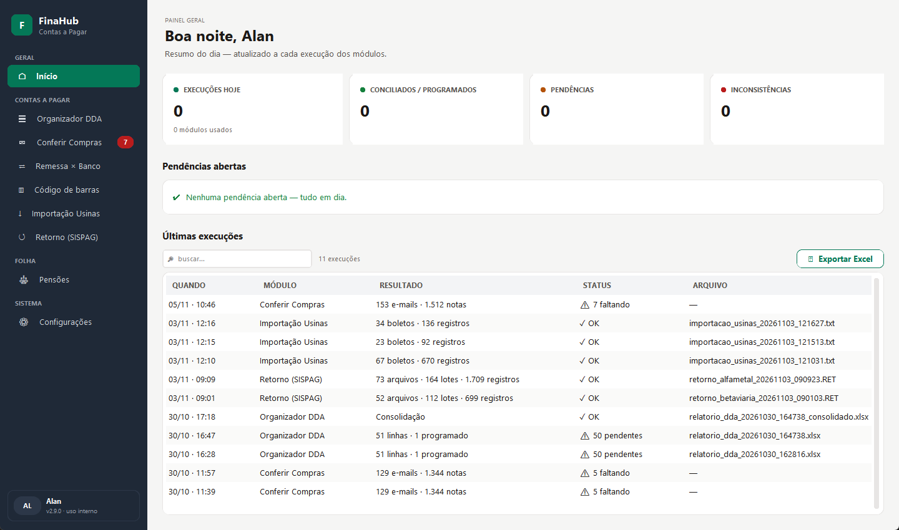

# FinaHub — CNAB240, SISPAG, DDA e conciliação

[](https://github.com/Alantustoni/finahub/actions/workflows/tests.yml)

Aplicativo desktop (Windows) que junta numa janela só as rotinas de um
setor de contas a pagar que antes rodavam em 5 executáveis separados:
arquivos bancários **CNAB240**, retorno **SISPAG Itaú**, planilha **DDA**,
conciliação **remessa × banco**, o pagamento mensal de **pensões** e a
conferência das notas que o setor de **Compras** envia por e-mail.

Está em uso diário desde jul/2026 num setor financeiro real. Este
repositório é a versão pública: **todos os dados são sintéticos** (CNPJs,
códigos de barras, agência/conta e nomes de empresas e fornecedores foram
trocados por valores fictícios com dígito verificador válido).



> **English summary** — Desktop app (Python + CustomTkinter) for accounts
> payable in Brazil. It merges and validates CNAB240 bank files (Bradesco /
> Itaú), combines SISPAG payment returns, reconciles the bank's DDA
> (electronic bill presentment) spreadsheet against scheduled payments, and
> reconciles ERP payment batches against the bank, turns the HR alimony
> report into an ERP import file, and checks the purchasing team's Outlook
> e-mails against the invoice spreadsheet. 114 automated tests.
> All data in this repo is synthetic.

---

## O que cada tela faz

| Tela | Problema real | Como resolve |
|---|---|---|
| **Código de barras (Juntador RET)** | Vários `.RET` CNAB240 de cobrança precisam virar um único arquivo de importação para o ERP. O programa antigo colava trailers fixos e o total saía errado. | Valida a estrutura, converte Itaú (341) → Bradesco (237), separa por empresa, filtra usinas, duplica títulos por CNPJ de filial, ordena por vencimento sem quebrar o par G + H/Y, renumera e **recalcula os trailers** de lote e de arquivo. |
| **Retorno (SISPAG)** | Retornos diários de pagamento do Itaú (segmentos A/B/J, vários lotes) precisam ser enviados juntos. | Valida header/trailer e pares de lote, rejeita arquivo de cobrança enviado por engano, renumera os lotes `0001..` e recalcula o trailer. |
| **Importação Usinas** | Boletos das usinas chegam numa planilha DDA, mas o ERP só lê CNAB240. | Monta registros segmento G a partir de um molde, tira o vencimento do **fator de vencimento do código de barras** (nova base Febraban de 22/02/2025) e avisa colisões de valor + vencimento. |
| **Organizador DDA** | Saber quais boletos do DDA já estão agendados no banco — e quais o setor de Compras já mandou. | Normaliza a planilha (dias úteis com feriados móveis), cruza com os extratos do banco em estágios — CNPJ → (data, valor) → nome fuzzy — com baixa 1:1, e garante que **nenhuma nota some sem aviso**. Marca como **"JÁ VEIO"** o que está na planilha de notas de Compras (NF + nome + vencimento → NF + vencimento → nome + vencimento, cada nota cobre um boleto só) e abrevia o nome do fornecedor sem perder o que o identifica. |
| **Conferir Compras** | A automação do e-mail de Compras (Power Automate + Office Script) pode pular notas sem ninguém perceber. | Lê a pasta de Compras do Outlook **só para leitura** (PowerShell/COM), extrai as notas da tabela do e-mail ou do assunto, compara com a planilha pelo ID do e-mail e pela chave empresa + fornecedor + NF e inclui as que faltaram, com backup antes. |
| **Pensões** | Todo mês o Excel do DP era colado à mão numa planilha, com PROCV limitado e divisão manual de quem paga mais de uma pensão. | Lê o relatório do DP direto do XML do `.xlsx` (o arquivo vem com estilos corrompidos), busca cada matrícula no cadastro, pede só o valor das pensões extras, confere a soma com o rodapé e gera o CSV de importação do ERP (`;`, CRLF, Windows-1252). Matrícula sem cadastro **bloqueia** em vez de virar `#N/A`. |
| **Remessa × Banco** | Conferir se tudo que saiu do ERP chegou ao banco. | Concilia em 3 passadas (exato → ±5 dias úteis → nome ≥ 75%) e detecta remessas inteiras ausentes. Lê Excel "difícil" com 6 alternativas (XML, openpyxl, xlrd, pandas, Excel COM, LibreOffice). |
| **Início / Configurações** | — | Dashboard do dia, histórico de execuções e uma configuração central com gravação atômica. |

## Antes × depois

O FinaHub nasceu reescrevendo ferramentas antigas que tinham bugs reais:

```python
# Juntador RET antigo (juntador_ret_v2.py): trailers com contadores fixos
LINHA_FINAL_1 = "23700025         000032000000000000000000000000000000000000000000"
LINHA_FINAL_2 = "23799999         000002000108"
```

Hoje os trailers são recalculados a partir do conteúdo. O modo antigo
continua disponível em Configurações, para comparação.

## Como rodar

```bash
pip install -r requirements.txt
python main.py
```

Não precisa de variável de ambiente nem de configuração prévia: na primeira
execução o app cria `~/.finahub/` com a config de fábrica. No
Windows também dá para usar `iniciar.bat`.

### Gerar o executável

```bash
pip install -r requirements-dev.txt
build.bat
```

Sai um `.exe` único em `dist\` que não precisa de Python instalado.

## Testes

```bash
pip install -r requirements-dev.txt
python -m pytest -q
```

114 testes (110 normais e 4 marcados como `xfail`, que documentam o
comportamento do modo legado). Cobrem, entre outros:

- montagem e trailers de CNAB240, conversão de banco, divisão em partes;
- fusão de retornos SISPAG e rejeição de arquivos inválidos;
- fator de vencimento e validação do molde (valor da barra = campo valor);
- cruzamento DDA × banco, conciliação e exportação para Excel;
- "JÁ VEIO" do DDA × Compras (ordem das regras, uma nota por boleto);
- leitura dos e-mails de Compras e comparação com a planilha;
- pensões: divisão entre pensionistas, título com ponto, bloqueios e
  leiaute do CSV;
- configuração central (merge, migração de versão, gravação atômica).

## Estrutura

```
finahub/
├── core/        config central, histórico, paths, tema, utils (valor/data BR)
├── modules/     regras de negócio, sem interface (ret, retorno, pensoes, ...)
├── ui/          interface CustomTkinter — uma tela por módulo
├── vendor/      motores de dois projetos anteriores do mesmo autor
│   ├── organizador_dda/   (Organizador DDA V7)
│   └── remessa_v3/        (Remessa × Banco V3)
└── resources/   config.json de fábrica
scripts/         utilitários de linha de comando (extrair notas, filtrar erros)
tests/           pytest
```

Os dados do usuário (config ativa, histórico e logs) ficam em
`~/.finahub/`, fora da pasta do programa.

## Layout CNAB240 — segmento G (usado pelo Juntador e pela Importação)

| Fatia (0-based) | Campo |
|---|---|
| `[17:61]` | Código de barras (44 dígitos) |
| `[62:77]` | Tipo + CNPJ do favorecido |
| `[77:107]` | Nome do favorecido |
| `[107:115]` | Vencimento (DDMMAAAA) |
| `[115:130]` | Valor (centavos) |
| `[147:162]` | "Seu número" = nº da nota |

## Stack

Python 3.13+ · CustomTkinter · pandas · openpyxl · numpy · rapidfuzz ·
xlrd · pytest · PyInstaller

## Licença

MIT — veja [LICENSE](LICENSE).
